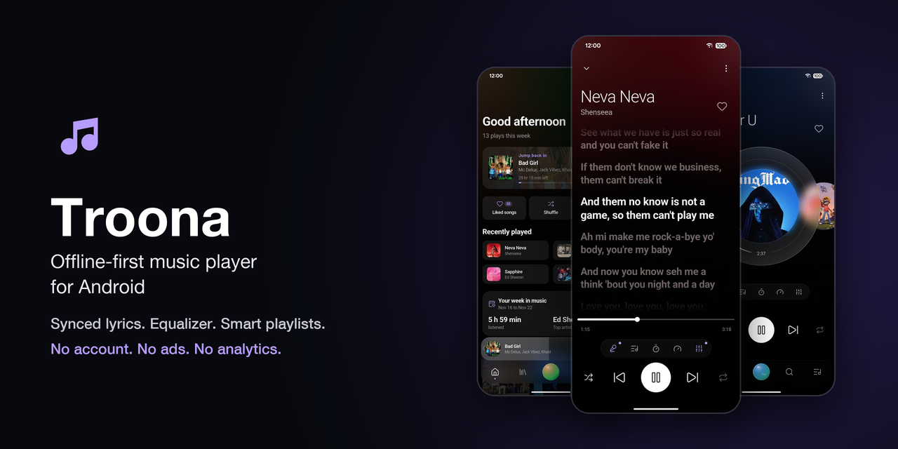
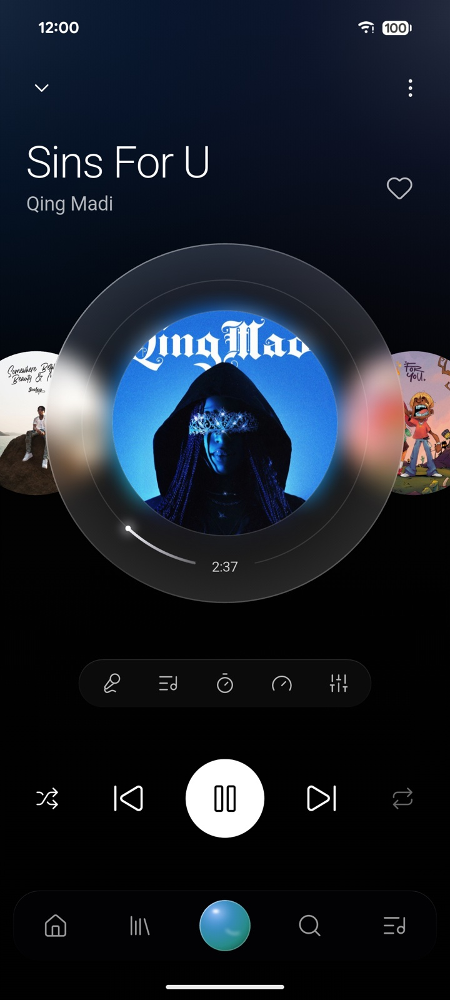
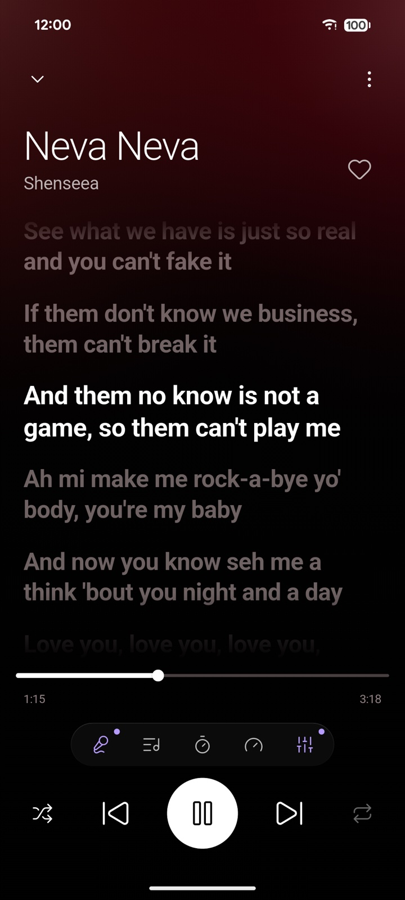
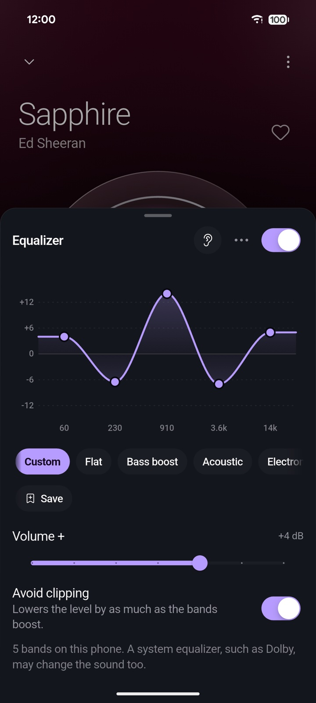
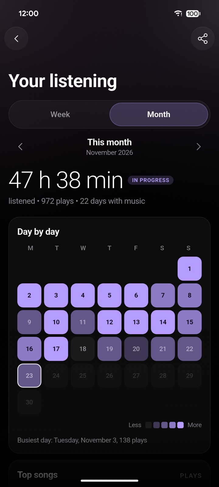
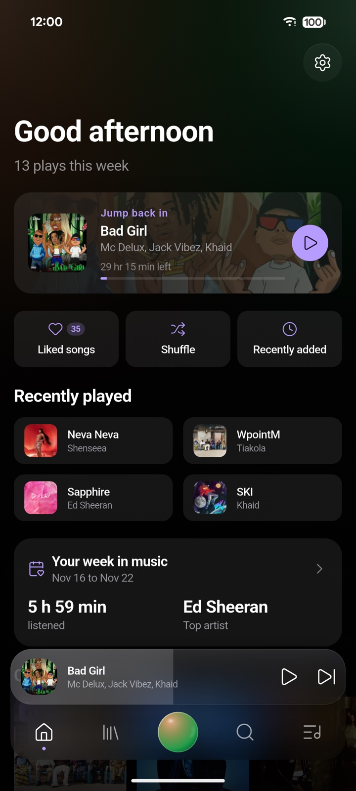
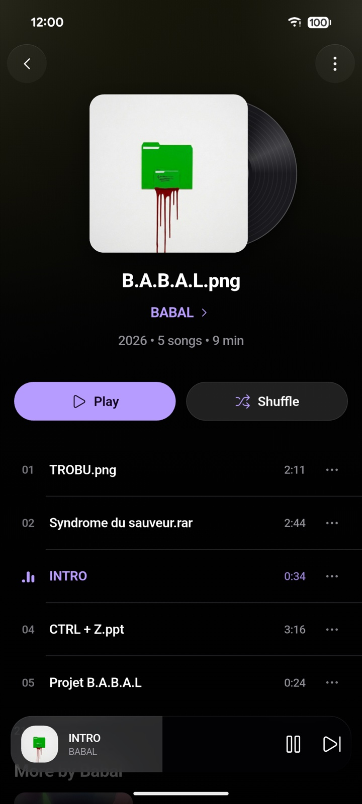
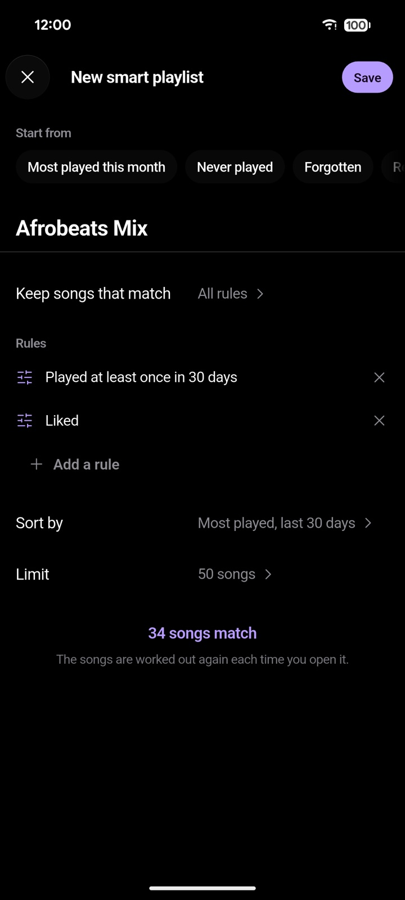
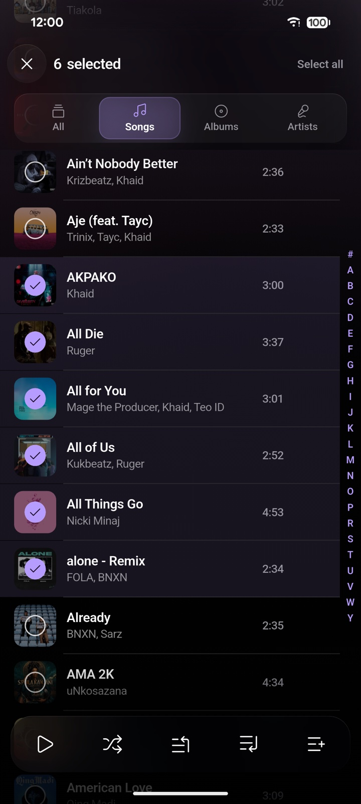

<p align="center">
  
</p>

<p align="center"><strong>A premium, offline-first music player for Android, with a glassmorphism interface inspired by iOS 17/18.</strong></p>

<p align="center">
  
  
  
  
  
  
</p>

<p align="center">
  <a href="#download">Download</a> •
  <a href="#features">Features</a> •
  <a href="#screenshots">Screenshots</a> •
  <a href="#tech-stack">Tech stack</a> •
  <a href="#getting-started">Getting started</a> •
  <a href="#architecture">Architecture</a> •
  <a href="#contributing">Contributing</a> •
  <a href="#privacy">Privacy</a>
</p>

---

## Download

<p align="center">
   <a href="https://github.com/donfreddy/troona-music/releases/latest"></a>
  &nbsp; &nbsp;
  <a href="https://www.openapk.net/troona/com.donfreddy.troona/"></a>
</p>

Troona is distributed as APKs on [GitHub Releases](https://github.com/donfreddy/troona-music/releases/latest). Most recent phones need `app-arm64-v8a-release.apk`; older 32-bit phones take `app-armeabi-v7a-release.apk`, and emulators `app-x86_64-release.apk`. Android 7.0 or later. It is not on Google Play or the App Store yet; you can also [build it from source](#getting-started).

---

Troona plays the music already on your phone. No account, no streaming catalogue, no ads, no analytics. Every byte of your library, your plays and your playlists stays on the device; the four online lookups it can make (artist bios, artist photos, song lyrics, update check) are opt-in, off by default, and documented in plain English in the [privacy policy](docs/privacy-policy.md).

It is also an engineering showcase: a Clean Architecture Flutter codebase with a Flutter-free domain layer, an audio engine fully isolated behind a port/adapter boundary, and a disciplined glassmorphism design system built for real device performance, not just a demo reel.

## Screenshots

https://github.com/user-attachments/assets/f2fe1340-86ac-49a2-a819-0ad3e520c172

<table>
  <tr>
    <td align="center"><br><sub>Your music, in its own colours</sub></td>
    <td align="center"><br><sub>Synced lyrics, line by line</sub></td>
    <td align="center"><br><sub>Shape the sound with a finger</sub></td>
    <td align="center"><br><sub>Your listening, week by week</sub></td>
  </tr>
  <tr>
    <td align="center"><br><sub>Back to your music in one tap</sub></td>
    <td align="center"><br><sub>Albums that feel like records</sub></td>
    <td align="center"><br><sub>Playlists that build themselves</sub></td>
    <td align="center"><br><sub>Pick, queue, done</sub></td>
  </tr>
</table>

## Features

Status reflects what is actually implemented and tested today, not a wishlist. See [`CHANGELOG.md`](CHANGELOG.md) for the full history.

### 🎧 Playback
- Gapless offline playback (`just_audio`) behind an `AudioServicePort` abstraction: the domain never imports `just_audio` directly
- Lock-screen and notification controls, backgrounded playback (`audio_service`)
- A like button in the system media controls (Android 13+), and the last session offered back there after the app is closed (Android 11+)
- Audio focus handling: ducks or pauses on notifications and calls, pauses instantly on headphone unplug, resumes after a call
- Smooth transitions: fade-in on play, fade-out before pause, a short crossfade around skips; auto-advance stays gapless
- Crossfade between songs (3 to 12 s, off by default), never between the songs of an album kept whole
- Smart transitions (Android): each song's silences and fade-out are found from its audio, on the phone, so the next song starts where the music really ends
- Sleep timer with a real 30 s fade-out (your volume setting is never touched) and an "end of song" mode
- Equalizer (Android): the phone's own bands drawn as one curve you shape with a finger, nine presets, your own named profiles, Volume +, a hold-to-compare button and an anti-clip trim; it survives backups
- Shuffle (Fisher–Yates) and repeat (off / one / all); a new list keeps shuffle on, or plays in order if you prefer
- Swipe a song to play it next or add it to the queue; swipe the mini player to change song, hold it to like
- Queue sheet: history, now playing and up next in one list, tap to jump, drag to reorder, swipe to remove with a 4 s undo
- Likes, persisted across sessions as a real playlist
- Open with (Android): an audio file touched in another app plays in Troona as the song of your library, found by its MediaStore id or its file name and size
- Synced lyrics in Now Playing: the line sung lit and followed, a tap on a line seeks there, a per-song timing correction, plain lyrics when that is all there is, the screen kept on while they play (or not, your choice). Import a `.lrc` file, or turn on the lyrics search (below)

### 📚 Library
- 4-phase device scan: query, diff, persist, artwork extraction (4 concurrent workers, de-duplicated)
- Isar-backed index (Rust core); rescans touch only what changed, with a live progress toast
- Keep folders out of the library (voice notes, podcasts) and choose the shortest song kept (10 s to 2 min); songs left out come back with their likes, plays and playlists when you let them in again
- Tracks, albums and artists, each with a dedicated detail page
- Correct a song's title, artist, album, year or cover, or an album's name, year and cover, from their menus: kept in Troona, never written to your files, applied on every scan so artists and albums regroup as if the tags had always been right
- Playlists: create, rename, delete, reorder, add/remove tracks
- Pick several songs at once with a long press, in any list: play, shuffle, queue them or add them to a playlist, in the list's order
- Smart playlists: rules on plays, last played, date added, likes, artist, album, genre, year, duration and lossless files, with templates, a sort and a limit; worked out again on each open, savable as a regular playlist
- Monthly "Replay" playlist, auto-built from last month's 25 most-played tracks, once a month
- Global search across tracks, artists and albums

### 🏠 Home & listening history
- Home leads with music: resume where you stopped, quick shortcuts, Recently played, recently added albums and last week's recap
- Persistent play history: a play counts after 30 s of listening (or half a track under a minute); seeking never counts. Pause it whenever you like
- Daily listening totals (plays, time, first plays, hours), kept forever
- Your listening: any week or month, with listening time, top songs, artists and albums, a calendar and when you listen most, shareable as a story image

### 🌐 Online extras, opt-in and off by default
- Artist and album bios via Last.fm
- Artist and album photos via Deezer
- Song lyrics via LRCLIB (synced), then lyrics.ovh (plain), asked only when you open a song's lyrics
- Each source has its own switch; turning photos off deletes what was downloaded; "Clear online info" wipes both caches
- Update check: asks GitHub once a day for the latest release and shows a card on Home; "Check for updates now" works with the switch off. Troona never downloads or installs anything: "View" opens the release page

### 🎨 Design
- Glassmorphism UI: real-time blur, translucent textures, gradients sampled from the current artwork
- Glass quality: Auto (chosen by device), Full, Balanced (blur in page headers only) or No blur, applied at once
- Seven accent colours, each tested for contrast, and a black background for the tabs
- Dark theme, portrait-locked; layouts adapt to the room on screen (down to 360 x 640 dp) and to the phone's font size

### ⚙️ Settings & maintenance
- Settings in pages (Audio, Library, Online extras, Appearance, Backup & restore, Storage, About), each row saying what it holds or how it stands, every switch saying what it does
- Audio: the equalizer, crossfade and smart transitions, keep shuffle, screen on with lyrics, duck on notification, pause on call, resume after call
- Library: what the library holds, folders and shortest song, pause listening history, rescan
- Appearance: accent colour, black background, glass quality, haptics, language
- Storage: clear cached covers / clear cached online info, each showing the size reclaimed, then the resets
- Version-gated "What's new" release-notes sheet, reachable anytime from Settings
- Help for the questions that come up most, each answer opening the setting that settles it
- Report a problem (local log, shared only if you choose to), privacy policy, open-source licences in the app's own pages
- Backup and restore: playlists (smart ones with their rules), likes, listening history, imported lyrics, song corrections, settings and the equalizer in a JSON file, each part yours to leave out. Automatic backups, daily or weekly, go to a folder you pick (no storage permission, kept if you uninstall), the last five kept beside the ones you make. Restoring offers the parts a backup holds; on another phone, songs are found again by file, then by tags, and restoring merges, so importing the same file twice changes nothing

### 🌍 Localization
- English and French, full 1:1 key parity, generated via `flutter gen-l10n`
- Follows the phone's language, or English or French chosen in Settings

> **On lyrics and cast:** early builds shipped demo versions of both, with no lyrics backend or cast protocol behind them, and a demo equalizer with no DSP. They were removed deliberately ahead of v1 rather than kept half-working. The equalizer came back as a real one, on Android's audio effects, and lyrics came back with real sources (your own `.lrc` files, LRCLIB and lyrics.ovh); cast remains a post-v1 discussion, not a promise.

## Roadmap

- [ ] Google Play release
- [ ] iOS release (the project has an iOS target, but no iOS build has been released)
- [ ] Localization beyond English and French
- [ ] Lyrics read from the audio files' own tags

Tracked in [Issues](https://github.com/donfreddy/troona-music/issues); released changes are listed in [`CHANGELOG.md`](CHANGELOG.md).

## Tech stack

| Layer                | Choice                                                    | Why                                                                                        |
|----------------------|-----------------------------------------------------------|--------------------------------------------------------------------------------------------|
| UI & framework       | Flutter 3.x / Dart 3                                      | Single codebase, native-feel glassmorphism without a web view                              |
| State management     | `flutter_bloc` (Bloc for Player/Library, Cubit elsewhere) | Predictable, testable state transitions; no implicit rebuild chains                        |
| Local database       | Isar (Rust core)                                          | Typed Dart schema, very fast reads, no SQL boilerplate for a local-only app                |
| Audio engine         | `just_audio` + `audio_service`                            | Gapless playback, lock-screen/notification integration, isolated behind `AudioServicePort` |
| File scanning        | `on_audio_query_pluse`                                    | Android MediaStore / iOS MediaLibrary access, patched to audio-only permissions            |
| Artwork palette      | `palette_generator_master`                                | Dominant-color extraction for the dynamic background                                       |
| Dependency injection | `get_it` (manual registration)                            | Explicit wiring in one file, no annotation magic to debug                                  |
| Navigation           | `go_router`                                               | `StatefulShellRoute` for the tab shell, modal routes for the player                        |
| Localization         | `flutter gen-l10n`                                        | ARB-based, type-safe generated accessors                                                   |

## Architecture

Feature-First + Clean Architecture: each feature under `lib/features/` is self-contained with `domain/`, `data/` and `presentation/` layers. The domain layer is pure Dart (no Flutter, no third-party I/O), and the audio engine is isolated behind a port/adapter boundary so the player logic never depends on `just_audio` directly.

```
feature/
├── domain/       # Entities, Repository interfaces, Use Cases: pure Dart, no Flutter
├── data/         # Models, DataSources, Repository implementations
└── presentation/ # Pages, Widgets, Bloc/Cubit
```

The full breakdown (module-by-module layout, the design system's token hierarchy, the `BackdropFilter` performance budget, storage schema and the test structure) lives in **[`docs/ARCHITECTURE.md`](docs/ARCHITECTURE.md)**.

## Getting started

### Prerequisites

- A Flutter release with Dart 3.10.8 or later, as `pubspec.yaml` requires (development and CI use Flutter 3.47.5)
- Android 7.0 (API 24) or later; the iOS target is set to iOS 13
- A device or emulator with local audio files to scan

### Installation

```bash
git clone https://github.com/donfreddy/troona-music.git
cd troona-music
flutter pub get
flutter run
```

### Required permissions

**Android** (`android/app/src/main/AndroidManifest.xml`):

```xml
<!-- Android 13+ -->
<uses-permission android:name="android.permission.READ_MEDIA_AUDIO" />
<!-- Android 12 and below -->
<uses-permission android:name="android.permission.READ_EXTERNAL_STORAGE"
    android:maxSdkVersion="32" />
<uses-permission android:name="android.permission.FOREGROUND_SERVICE" />
<uses-permission android:name="android.permission.FOREGROUND_SERVICE_MEDIA_PLAYBACK" />
<uses-permission android:name="android.permission.POST_NOTIFICATIONS" />
<uses-permission android:name="android.permission.WAKE_LOCK" />
<!-- Only used for the opt-in online bios, photos, lyrics and update check, never for playback -->
<uses-permission android:name="android.permission.INTERNET" />
```

**iOS** (`Info.plist`):

```xml
<key>NSAppleMusicUsageDescription</key>
<string>Troona accesses your music library to play local files.</string>
<key>UIBackgroundModes</key>
<array>
  <string>audio</string>
</array>
```

### Commands

```bash
flutter analyze                                              # Static analysis
flutter test                                                 # Full test suite
flutter test test/unit/player/queue_test.dart                 # A single test file
dart run build_runner build --delete-conflicting-outputs      # Regenerate Isar code after a schema change (generated files are committed)
```

Tests live in `test/unit/` (pure logic, blocs, repositories) and `test/widget/`. Shared player test doubles (`FakeAudioPort`, `buildTestPlayerBloc`, `testTrack`) are in `test/helpers/fake_player.dart`. Isar tests run against the real engine: there is no mocked persistence layer.

## Contributing

Contributions are welcome: bug reports, fixes, translations and well-scoped features alike. Read **[`CONTRIBUTING.md`](CONTRIBUTING.md)** before opening a PR: it covers the local setup, coding conventions, the commit format and what a review is looking for. Everyone participating is expected to follow the **[Code of Conduct](CODE_OF_CONDUCT.md)**.

## Design credit

Troona's glassmorphism direction started from a concept by **[Shimon Bar Yacov](https://www.behance.net/shimon-bar-yacov)**, Product Design Director at [AmazingUI](https://amazingui.com), published on [Behance](https://www.behance.net/gallery/233232089/Music-App-Modern-Music-Player-by-AmazingUI). Only a handful of screens were ever published there, as a concept, not a shipped product. Everything behind them, including every screen beyond the first few, the architecture, the audio engine and the entire codebase, is original work built from scratch for this repository.

## Privacy

Troona has no account, no ads and no analytics. Your library, likes, playlists and listening history never leave the device. The four online lookups it can make (artist bios via Last.fm, artist/album photos via Deezer, song lyrics via LRCLIB then lyrics.ovh, the latest release number via GitHub) are opt-in and independently toggled. Bios send only artist and album names. Photos send those names plus up to three titles of each artist's most played songs, so the photo found is of that artist and not a namesake. Lyrics send a song's title, artist, album and length, only when you open the lyrics of a song that has none stored. The update check sends nothing about you or your music. Full detail in **[`docs/privacy-policy.md`](docs/privacy-policy.md)**.

## License

Distributed under the **MIT License**. See [`LICENSE`](LICENSE) for details.
