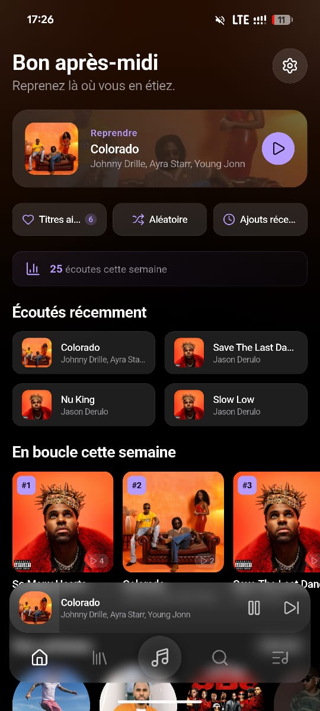
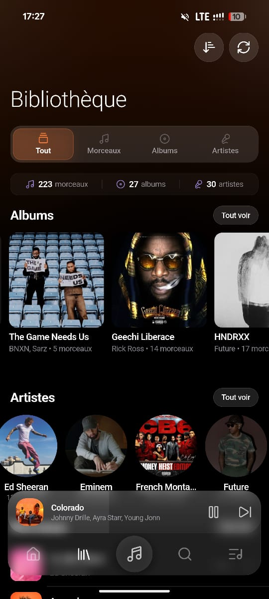
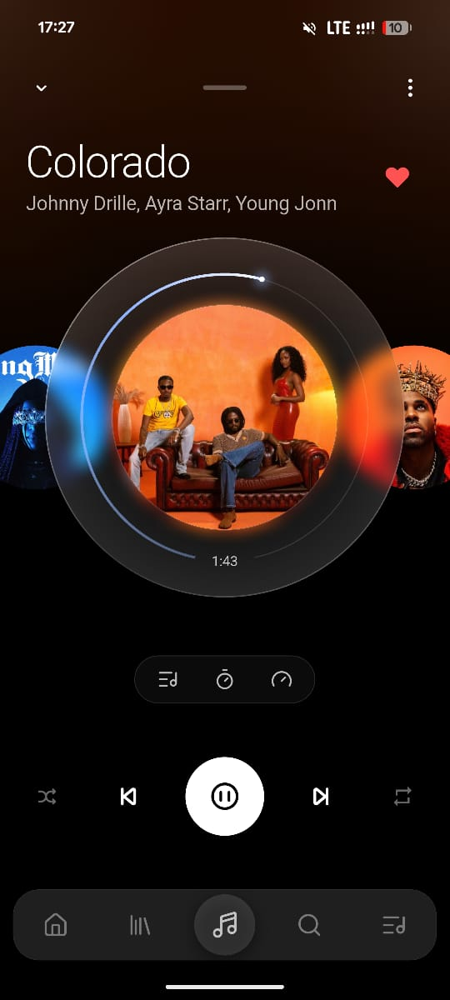
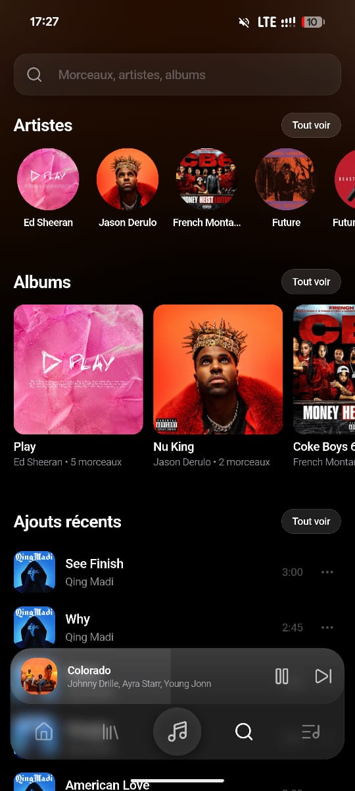
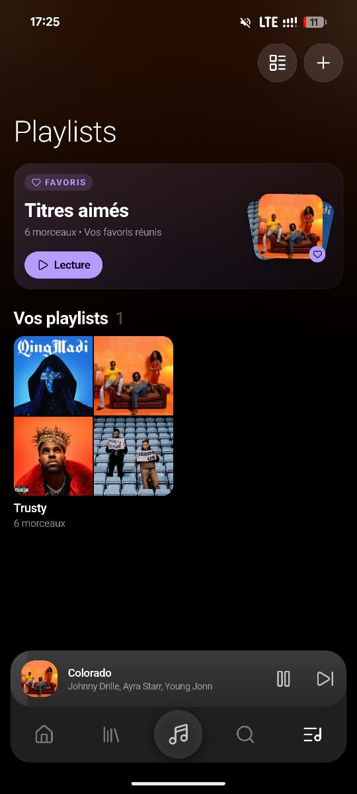
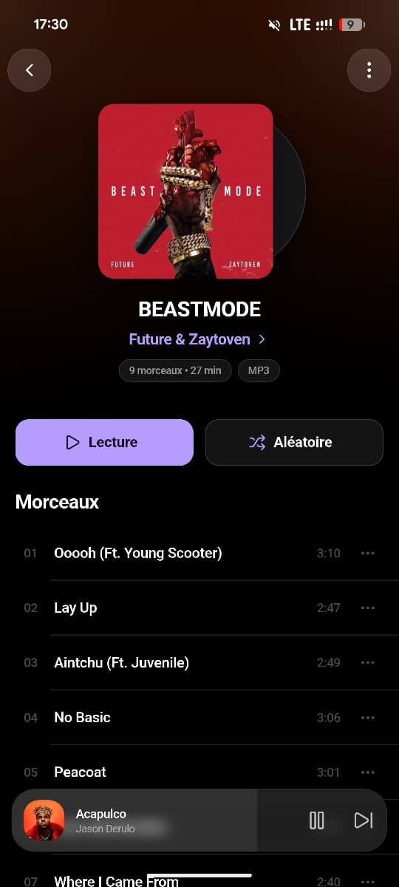
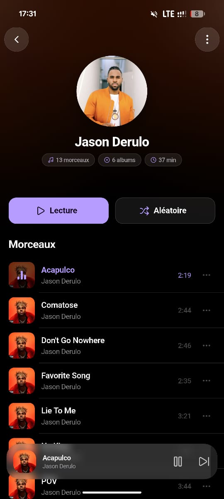

<p align="center">
  
</p>

<h1 align="center">Troona</h1>
<p align="center"><strong>A premium, offline-first music player for Android, with a glassmorphism interface inspired by iOS 17/18.</strong></p>

<p align="center">
  
  
  
  
  
  
</p>

<p align="center">
  <a href="#download">Download</a> •
  <a href="#features">Features</a> •
  <a href="#screenshots">Screenshots</a> •
  <a href="#tech-stack">Tech stack</a> •
  <a href="#getting-started">Getting started</a> •
  <a href="#architecture">Architecture</a> •
  <a href="#contributing">Contributing</a> •
  <a href="#privacy">Privacy</a>
</p>

---

## Download

<p align="center">
  <a href="https://github.com/donfreddy/troona-music/releases/latest"></a>
</p>

Troona is distributed as APKs on [GitHub Releases](https://github.com/donfreddy/troona-music/releases/latest). Most recent phones need `app-arm64-v8a-release.apk`; older 32-bit phones take `app-armeabi-v7a-release.apk`, and emulators `app-x86_64-release.apk`. Android 7.0 or later. It is not on Google Play or the App Store yet; you can also [build it from source](#getting-started).

---

Troona plays the music already on your phone. No account, no streaming catalogue, no ads, no analytics. Every byte of your library, your plays and your playlists stays on the device; the two online lookups it can make (artist bios, artist photos) are opt-in, off by default, and documented in plain English in the [privacy policy](docs/privacy-policy.md).

It is also an engineering showcase: a Clean Architecture Flutter codebase with a Flutter-free domain layer, an audio engine fully isolated behind a port/adapter boundary, and a disciplined glassmorphism design system built for real device performance, not just a demo reel.

## Screenshots

<table>
  <tr>
    <td align="center"><br><sub>Home</sub></td>
    <td align="center"><br><sub>Library</sub></td>
    <td align="center"><br><sub>Now Playing</sub></td>
    <td align="center"><br><sub>Search</sub></td>
  </tr>
  <tr>
    <td align="center"><br><sub>Playlists</sub></td>
    <td align="center"><br><sub>Album</sub></td>
    <td align="center"><br><sub>Artist (Last.fm/Deezer bio)</sub></td>
    <td></td>
  </tr>
</table>

## Features

Status reflects what is actually implemented and tested today, not a wishlist. See [`CHANGELOG.md`](CHANGELOG.md) for the full history.

### 🎧 Playback
- Gapless offline playback (`just_audio`) behind an `AudioServicePort` abstraction: the domain never imports `just_audio` directly
- Lock-screen and notification controls, backgrounded playback (`audio_service`)
- Audio focus handling: ducks or pauses on notifications and calls, pauses instantly on headphone unplug, resumes after a call
- Smooth transitions: fade-in on play, fade-out before pause, a short crossfade around skips; auto-advance stays gapless
- Sleep timer with a real 30 s fade-out (your volume setting is never touched) and an "end of song" mode
- Shuffle (Fisher–Yates) and repeat (off / one / all)
- Queue sheet: history, now playing and up next in one list, tap to jump, drag to reorder, swipe to remove with a 4 s undo
- Likes, persisted across sessions as a real playlist

### 📚 Library
- 4-phase device scan: query, diff, persist, artwork extraction (4 concurrent workers, de-duplicated)
- Isar-backed index (Rust core); rescans touch only what changed, with a live progress toast
- Tracks, albums and artists, each with a dedicated detail page
- Playlists: create, rename, delete, reorder, add/remove tracks
- Monthly "Replay" playlist, auto-built from last month's 25 most-played tracks, once a month
- Global search across tracks, artists and albums

### 🏠 Home & listening history
- Recently Played, Your Artists, New Albums, Your Playlists
- Persistent play history: a play counts after 30 s of listening (or half a track under a minute); seeking never counts
- Daily listening totals (plays, time, first plays), kept forever
- "Your week in music": a weekly recap with top artist/song, first listens and a monthly listening calendar

### 🌐 Online extras, opt-in and off by default
- Artist and album bios via Last.fm
- Artist and album photos via Deezer
- Each source has its own switch; turning photos off deletes what was downloaded; "Clear online info" wipes both caches

### 🎨 Design
- Glassmorphism UI: real-time blur, translucent textures, gradients sampled from the current artwork
- Glass quality: Auto (chosen by device), Full, Light or Off, applied at runtime and tuned for low-end devices
- Dark theme, portrait-locked, responsive sizing via `flutter_screenutil`

### ⚙️ Settings & maintenance
- Playback toggles (duck on notification, pause on call, resume after call), glass quality, haptics
- Clear cached covers / clear cached online info, each showing the size reclaimed
- Version-gated "What's new" release-notes sheet, reachable anytime from Settings
- Report a problem (local log, shared only if you choose to), privacy policy, open-source licenses

### 🌍 Localization
- English and French, full 1:1 key parity, generated via `flutter gen-l10n`

> **On the equalizer, lyrics and cast:** early builds shipped demo versions of all three with no real DSP, lyrics backend or cast protocol behind them. They were removed deliberately ahead of v1 rather than kept half-working. A real implementation of any of them is a post-v1 discussion, not a promise.

## Roadmap

- [ ] Google Play release
- [ ] iOS release (the project has an iOS target, but no iOS build has been released)
- [ ] Localization beyond English and French
- [ ] Revisit a real equalizer and synced lyrics, scoped properly this time

Tracked in [Issues](https://github.com/donfreddy/troona-music/issues); released changes are listed in [`CHANGELOG.md`](CHANGELOG.md).

## Tech stack

| Layer                | Choice                                                    | Why                                                                                        |
|----------------------|-----------------------------------------------------------|--------------------------------------------------------------------------------------------|
| UI & framework       | Flutter 3.x / Dart 3                                      | Single codebase, native-feel glassmorphism without a web view                              |
| State management     | `flutter_bloc` (Bloc for Player/Library, Cubit elsewhere) | Predictable, testable state transitions; no implicit rebuild chains                        |
| Local database       | Isar (Rust core)                                          | Typed Dart schema, very fast reads, no SQL boilerplate for a local-only app                |
| Audio engine         | `just_audio` + `audio_service`                            | Gapless playback, lock-screen/notification integration, isolated behind `AudioServicePort` |
| File scanning        | `on_audio_query_pluse`                                    | Android MediaStore / iOS MediaLibrary access, patched to audio-only permissions            |
| Artwork palette      | `palette_generator_master`                                | Dominant-color extraction for the dynamic background                                       |
| Dependency injection | `get_it` (manual registration)                            | Explicit wiring in one file, no annotation magic to debug                                  |
| Navigation           | `go_router`                                               | `StatefulShellRoute` for the tab shell, modal routes for the player                        |
| Localization         | `flutter gen-l10n`                                        | ARB-based, type-safe generated accessors                                                   |

## Architecture

Feature-First + Clean Architecture: each feature under `lib/features/` is self-contained with `domain/`, `data/` and `presentation/` layers. The domain layer is pure Dart (no Flutter, no third-party I/O), and the audio engine is isolated behind a port/adapter boundary so the player logic never depends on `just_audio` directly.

```
feature/
├── domain/       # Entities, Repository interfaces, Use Cases: pure Dart, no Flutter
├── data/         # Models, DataSources, Repository implementations
└── presentation/ # Pages, Widgets, Bloc/Cubit
```

The full breakdown (module-by-module layout, the design system's token hierarchy, the `BackdropFilter` performance budget, storage schema and the test structure) lives in **[`docs/ARCHITECTURE.md`](docs/ARCHITECTURE.md)**.

## Getting started

### Prerequisites

- A Flutter release with Dart 3.10.8 or later, as `pubspec.yaml` requires (development and CI use Flutter 3.47.5)
- Android 7.0 (API 24) or later; the iOS target is set to iOS 13
- A device or emulator with local audio files to scan

### Installation

```bash
git clone https://github.com/donfreddy/troona-music.git
cd troona-music
flutter pub get
flutter run
```

### Required permissions

**Android** (`android/app/src/main/AndroidManifest.xml`):

```xml
<!-- Android 13+ -->
<uses-permission android:name="android.permission.READ_MEDIA_AUDIO" />
<!-- Android 12 and below -->
<uses-permission android:name="android.permission.READ_EXTERNAL_STORAGE"
    android:maxSdkVersion="32" />
<uses-permission android:name="android.permission.FOREGROUND_SERVICE" />
<uses-permission android:name="android.permission.FOREGROUND_SERVICE_MEDIA_PLAYBACK" />
<uses-permission android:name="android.permission.POST_NOTIFICATIONS" />
<uses-permission android:name="android.permission.WAKE_LOCK" />
<!-- Only used for the opt-in online bios/photos, never for playback -->
<uses-permission android:name="android.permission.INTERNET" />
```

**iOS** (`Info.plist`):

```xml
<key>NSAppleMusicUsageDescription</key>
<string>Troona accesses your music library to play local files.</string>
<key>UIBackgroundModes</key>
<array>
  <string>audio</string>
</array>
```

### Commands

```bash
flutter analyze                                              # Static analysis
flutter test                                                 # Full test suite
flutter test test/unit/player/queue_test.dart                 # A single test file
dart run build_runner build --delete-conflicting-outputs      # Regenerate Isar code after a schema change (generated files are committed)
```

Tests live in `test/unit/` (pure logic, blocs, repositories) and `test/widget/`. Shared player test doubles (`FakeAudioPort`, `buildTestPlayerBloc`, `testTrack`) are in `test/helpers/fake_player.dart`. Isar tests run against the real engine: there is no mocked persistence layer.

## Contributing

Contributions are welcome: bug reports, fixes, translations and well-scoped features alike. Read **[`CONTRIBUTING.md`](CONTRIBUTING.md)** before opening a PR: it covers the local setup, coding conventions, the commit format and what a review is looking for. Everyone participating is expected to follow the **[Code of Conduct](CODE_OF_CONDUCT.md)**.

## Design credit

Troona's glassmorphism direction started from a concept by **[Shimon Bar Yacov](https://www.behance.net/shimon-bar-yacov)**, Product Design Director at [AmazingUI](https://amazingui.com), published on [Behance](https://www.behance.net/gallery/233232089/Music-App-Modern-Music-Player-by-AmazingUI). Only a handful of screens were ever published there, as a concept, not a shipped product. Everything behind them, including every screen beyond the first few, the architecture, the audio engine and the entire codebase, is original work built from scratch for this repository.

## Privacy

Troona has no account, no ads and no analytics. Your library, likes, playlists and listening history never leave the device. The two online lookups it can make (artist bios via Last.fm, artist/album photos via Deezer) are opt-in, independently toggled, and send nothing beyond an artist/album name. Full detail in **[`docs/privacy-policy.md`](docs/privacy-policy.md)**.

## License

Distributed under the **MIT License**. See [`LICENSE`](LICENSE) for details.
